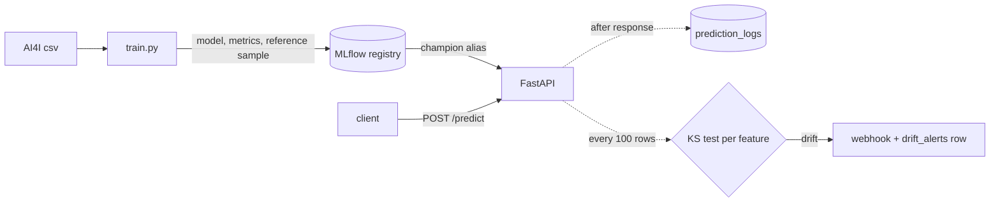

# ML Inference Pipeline

An XGBoost machine failure classifier on the public AI4I 2020 dataset, served with FastAPI, with an MLflow registry (promote and rollback), prediction logging to PostgreSQL and KS-test drift alerts to a webhook. A personal project for showing the full model lifecycle on public data.

Topics: `mlops` `xgboost` `fastapi` `mlflow` `predictive-maintenance` `drift-detection` `docker-compose` `postgresql`


## Results

Held-out test split: 2000 of the 10000 rows, 68 of them failures. Failure class, threshold 0.5. Command: `make eval` (writes `results/metrics.md`).

| model | precision | recall | F1 | PR-AUC |
|---|---|---|---|---|
| always predict normal | 0.000 | 0.000 | 0.000 | 0.034 |
| random forest | 0.966 | 0.824 | 0.889 | 0.893 |
| XGBoost, raw features | 0.917 | 0.647 | 0.759 | 0.828 |
| **XGBoost, final** | 0.931 | 0.794 | 0.857 | 0.890 |

Confusion matrix of the final model (rows actual, columns predicted):

| | predicted normal | predicted failure |
|---|---|---|
| actual normal | 1928 | 4 |
| actual failure | 14 | 54 |

The random forest scores a little higher than XGBoost here. With 68 failures in the test set, a gap of a few cases is within noise, so I kept XGBoost as the served model. These numbers came from macOS arm64; a Linux run can differ in the last digit.

The AI4I data is synthetic, published by its author for research. It is not logs from a real plant.

## How it works



- Training splits 80/20 (stratified), builds features, fits XGBoost, and logs metrics, the confusion matrix and a sample of the training data to MLflow.
- A new version is promoted to the `champion` alias only if precision and recall pass a gate (0.70 and 0.60) and its F1 is not below the current champion. The old champion becomes `previous`.
- `POST /models/rollback` moves `champion` back to `previous`. `POST /models/promote` promotes any version. Both reload the model in the API.
- `/predict` returns the answer first. Writing the row to the database and the drift check run afterwards as FastAPI background tasks, so a database error never fails a prediction.
- Every 100 requests the KS test compares each feature in that window to the training sample of the serving model. A p-value below 0.05 divided by the number of features counts as drift. One alert per hour fires the webhook and writes a row.

## Design choices

- **Engineered features.** Torque times speed (power), process minus air temperature, and tool wear times torque follow how the dataset defines its failure modes. Cross-validated F1 on the training rows went from 0.704 to 0.848 (`results/metrics.md`).
- **No class weighting.** Weighting the rare class raised recall to 0.841 but dropped precision to 0.781 and F1 to 0.810 in cross-validation, so I kept the unweighted model and the 0.5 threshold.
- **Aliases instead of MLflow stages.** Stages are deprecated. Two aliases (`champion`, `previous`) give promote and rollback with no extra state. Rollback clears `previous`, so a bad version is only re-promoted on purpose.
- **Bonferroni on the KS test.** Testing nine features at 0.05 each would raise false alarms on healthy traffic, so the threshold is divided by nine.
- **SQLite and MLflow files for the demo.** `make demo` needs no services. Docker Compose runs the same code on PostgreSQL and an MLflow server.

Not done: this has never been deployed to SageMaker or any cloud. It is a plain FastAPI container. A SageMaker custom container would need `/ping` and `/invocations` on port 8080 and model loading from `/opt/ml/model`, none of which is implemented here.

## Run it

Needs Python 3.12 or 3.13 (the pinned packages have no wheels for 3.14 yet); `make install` picks 3.13, then 3.12. On macOS, XGBoost also needs `brew install libomp`.

```bash
make install   # creates .venv, installs pinned dependencies
make demo      # trains 3 versions, promotes, rolls back, serves, replays traffic, fires a drift alert
make eval      # precision, recall, confusion matrix on the held-out split
```

Full stack with PostgreSQL and an MLflow server (MLflow UI on http://localhost:5001, API docs on http://localhost:8000/docs):

```bash
make compose-demo   # builds, trains, starts the API, replays 300 readings, prints the logged row count
make down           # stops everything and deletes the volumes
```

Example request:

```bash
curl -s localhost:8000/predict -H 'content-type: application/json' -d '{
  "machine_id": "M-1", "product_type": "L", "air_temperature_k": 298.1,
  "process_temperature_k": 308.6, "rotational_speed_rpm": 1551,
  "torque_nm": 42.8, "tool_wear_min": 0}'
```

Set `ALERT_WEBHOOK_URL` in `.env` (see `.env.example`) to receive drift alerts. The dataset is committed at `data/raw/ai4i2020.csv`; `make data` re-downloads it from UCI and checks its SHA-256. Source: Matzka (2020), AI4I 2020 Predictive Maintenance Dataset, UCI Machine Learning Repository, CC BY 4.0.

## Tests

```bash
make test   # 41 tests, fails under 85% coverage
make lint   # ruff
```

The tests train real models on the committed data in a temp directory and cover the registry, the promotion gate, the API, background logging, drift detection and the webhook. CI runs them on Python 3.12 and 3.13, runs `make demo` and `make eval`, and starts the Docker Compose stack.

## What I'd do next

- Tune the decision threshold for the cost of a missed failure instead of using 0.5.
- Keep the drift window state in the database so it survives restarts and works with several API workers.
- Add a retraining trigger when drift persists across several windows.
- Try the failure modes (tool wear, heat, power, overstrain) as separate classes.
