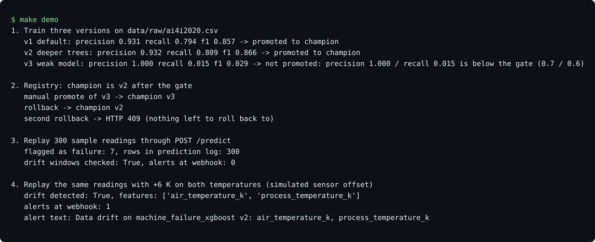
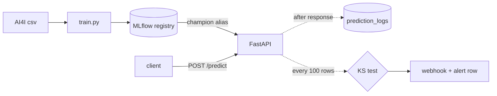

# ML Inference Pipeline

An XGBoost machine failure classifier on the public AI4I 2020 dataset, served with FastAPI, with an MLflow registry (promote and rollback), prediction logging to PostgreSQL and KS-test drift alerts to a webhook.

Topics: `mlops` `xgboost` `fastapi` `mlflow` `predictive-maintenance` `drift-detection` `docker-compose` `postgresql`



## Results

Held-out test split (2000 rows, 68 failures), failure class, threshold 0.5, synthetic AI4I data. Command: `make eval`. Caveats and ablations: [docs/RESULTS.md](docs/RESULTS.md).

| model | precision | recall | F1 | PR-AUC |
|---|---|---|---|---|
| always predict normal | 0.000 | 0.000 | 0.000 | 0.034 |
| random forest | 0.966 | 0.824 | 0.889 | 0.893 |
| XGBoost, raw features | 0.917 | 0.647 | 0.759 | 0.828 |
| **XGBoost, final** | 0.931 | 0.794 | 0.857 | 0.890 |

Final model confusion matrix: 1928 true normal, 4 false alarms, 14 missed failures, 54 caught failures.

## How it works



- Training splits 80/20 (stratified) and logs the model, metrics and a training sample to MLflow.
- A version becomes `champion` only if precision and recall pass a gate (0.70 and 0.60) and F1 is not below the current champion.
- `POST /models/rollback` moves `champion` back to `previous`.
- `/predict` answers first; logging and the drift check run afterwards as background tasks.
- Every 100 requests a KS test compares each feature to the training sample; one alert per hour.

## Design choices

- **Engineered features** follow how the dataset defines its failure modes; cross-validated F1 went from 0.704 to 0.848.
- **No class weighting:** it raised recall to 0.841 but dropped precision to 0.781 and F1 to 0.810 in cross-validation.
- **Aliases, not MLflow stages**, which are deprecated; two aliases give promote and rollback with no extra state.
- **Bonferroni on the KS test:** nine features at 0.05 each would raise false alarms on healthy traffic.
- **SQLite and MLflow files for the demo**, so `make demo` needs no services; Compose runs PostgreSQL.

## Run it

Needs Python 3.12 or 3.13 (the pinned packages have no wheels for 3.14 yet); `make install` picks 3.13, then 3.12. On macOS, XGBoost also needs `brew install libomp`.

```bash
make install   # creates .venv, installs pinned dependencies
make demo      # trains 3 versions, promotes, rolls back, serves, replays traffic, fires a drift alert
make eval      # precision, recall, confusion matrix on the held-out split
```

Full stack with PostgreSQL and an MLflow server (MLflow UI on http://localhost:5001, API docs on http://localhost:8000/docs):

```bash
make compose-demo   # builds, trains, starts the API, replays 300 readings, prints the logged row count
make down           # stops everything and deletes the volumes
```

Example request:

```bash
curl -s localhost:8000/predict -H 'content-type: application/json' -d '{
  "machine_id": "M-1", "product_type": "L", "air_temperature_k": 298.1,
  "process_temperature_k": 308.6, "rotational_speed_rpm": 1551,
  "torque_nm": 42.8, "tool_wear_min": 0}'
```

Set `ALERT_WEBHOOK_URL` in `.env` (see `.env.example`) to receive drift alerts. The dataset is committed at `data/raw/ai4i2020.csv`; `make data` re-downloads it from UCI and checks its SHA-256. Source: Matzka (2020), AI4I 2020 Predictive Maintenance Dataset, UCI Machine Learning Repository, CC BY 4.0.

## Tests

```bash
make test   # 41 tests, fails under 85% coverage
make lint   # ruff
```

The tests train real models on the committed data in a temp directory and cover the registry, the promotion gate, the API, background logging, drift detection and the webhook. CI runs them on Python 3.12 and 3.13, runs `make demo` and `make eval`, and starts the Docker Compose stack.

## What I'd do next

- Tune the decision threshold for the cost of a missed failure instead of using 0.5.
- Keep the drift window state in the database so it survives restarts and works with several API workers.
- Add a retraining trigger when drift persists across several windows.
- Try the failure modes (tool wear, heat, power, overstrain) as separate classes.
